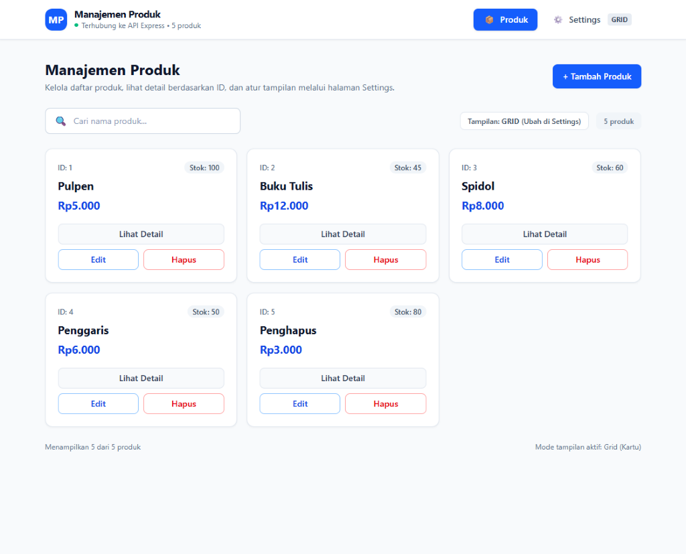
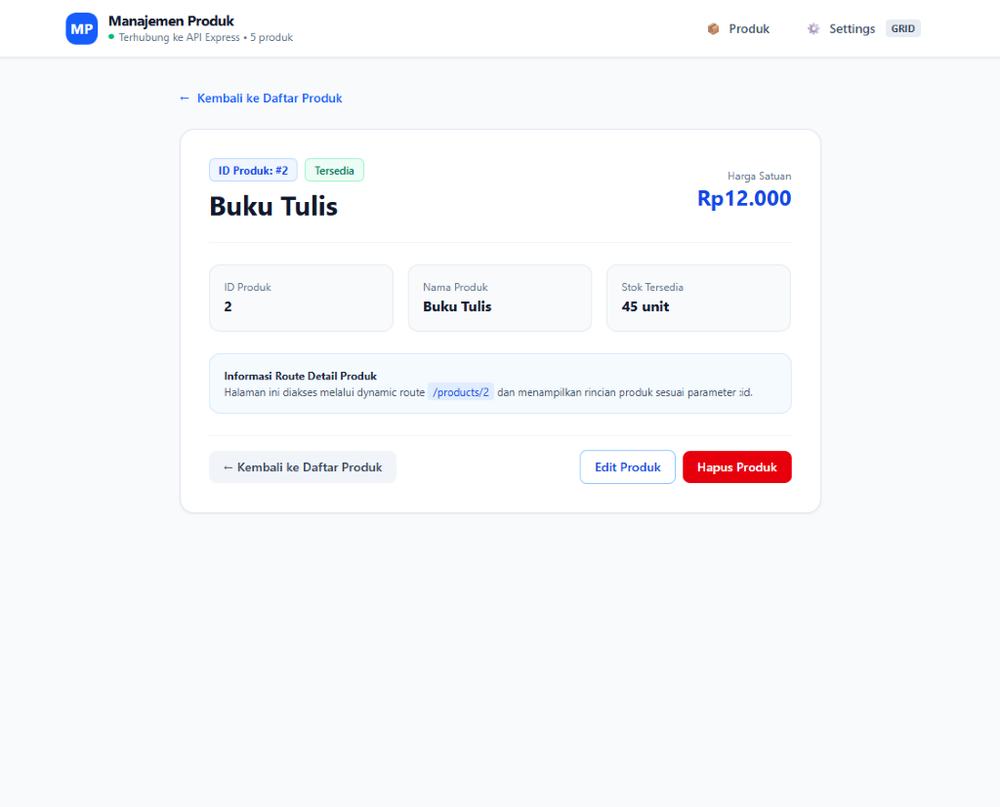
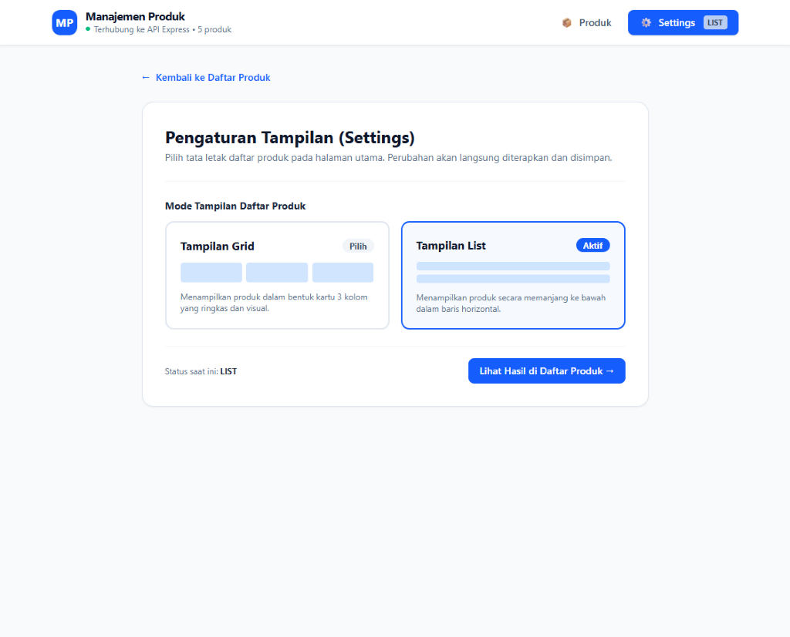
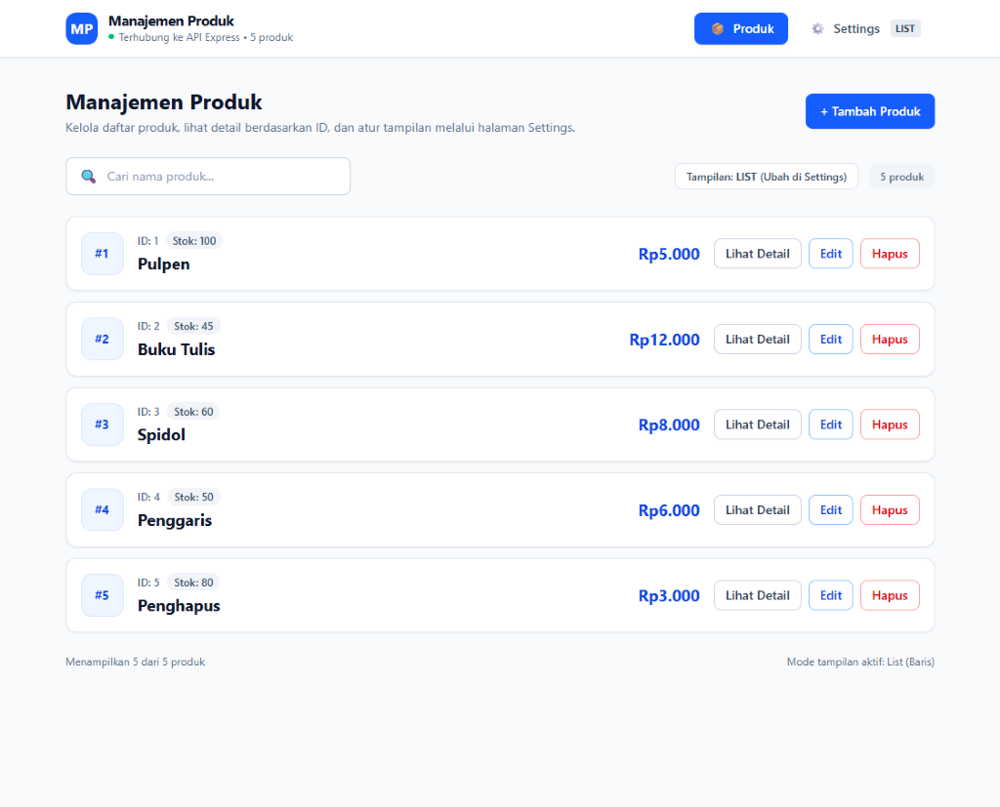
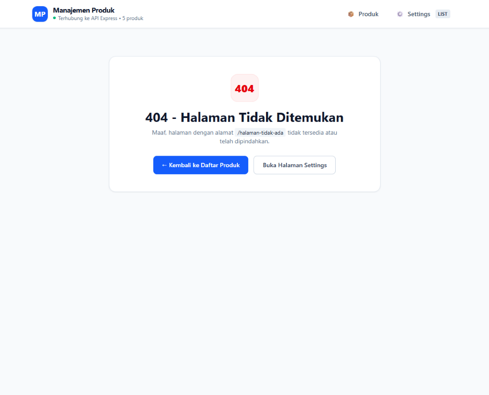

# Manajemen Produk — React Router, Tailwind CSS & Integrasi ExpressJS (Tugas 4)

Aplikasi **Manajemen Produk** berbasis **React (Vite)** yang dikembangkan dari proyek CRUD sebelumnya menggunakan **React Router (`react-router-dom`)** dan **Tailwind CSS**, serta terintegrasi penuh dengan REST API **ExpressJS + Prisma ORM**.

## Fitur Utama

1. **CRUD Produk Tetap Bekerja (`/`)**
   - Menampilkan daftar produk dari REST API ExpressJS (`GET /products`) lengkap dengan fitur pencarian nama produk secara real-time.
   - Menambah produk baru (`POST /products`) dan memperbarui produk (`PUT /products/:id`) melalui modal dengan validasi input.
   - Menghapus produk (`DELETE /products/:id`) dengan modal konfirmasi hapus.
2. **Halaman Detail Produk (`/products/:id`)**
   - Menampilkan detail data produk (ID, Nama, Harga, dan Stok) sesuai parameter `:id` serta menyediakan tautan kembali (`← Kembali ke Daftar Produk`).
3. **Pengaturan Tampilan Grid / List (`/settings`)**
   - Halaman pengaturan untuk mengubah tata letak daftar produk antara **Tampilan Grid** (kartu 3 kolom) dan **Tampilan List** (baris horizontal).
4. **Halaman 404 Not Found (`*`)**
   - Menampilkan pesan jelas saat pengguna mengakses rute yang tidak valid disertai tautan kembali ke daftar produk.

## Bukti Pengujian

| Skenario | Hasil yang Diharapkan | Hasil Aktual |
|---|---|---|
| Membuka halaman daftar produk (`/`) | Daftar produk dari API ditampilkan dan operasi CRUD (tambah, lihat, edit, hapus) berjalan | Sesuai |
| Memilih salah satu produk (`/products/:id`) | Detail produk sesuai ID ditampilkan beserta Link kembali ke daftar produk | Sesuai |
| Mengubah mode tampilan Grid/List di `/settings` | Tata letak daftar produk pada halaman utama berubah antara Grid dan List | Sesuai |
| Mengakses URL yang tidak terdaftar (`/halaman-tidak-ada`) | Halaman 404 menampilkan pesan jelas dan tautan kembali ke daftar produk | Sesuai |

### Screenshot Pengujian

1. **Daftar Produk — Tampilan Grid (`/`)**
   

2. **Detail Produk sesuai ID (`/products/2`)**
   

3. **Halaman Settings — Ubah Tampilan Grid / List (`/settings`)**
   

4. **Daftar Produk — Tampilan List (`/`)**
   

5. **Halaman 404 Not Found (`/halaman-tidak-ada`)**
   
